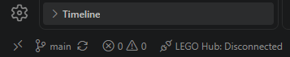
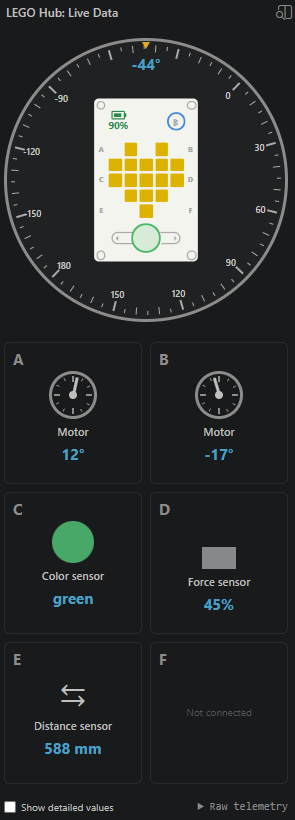
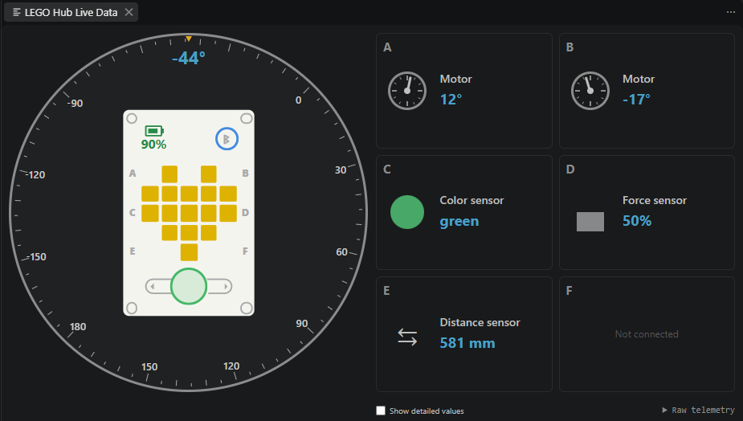

# LEGO SPIKE Prime / MINDSTORMS Robot Inventor Extension

This extension helps you connect to the SPIKE Prime or MINDSTORMS Robot Inventor brick and perform various operations on it.

> [!IMPORTANT]  
> Starting with version 2.x of the extension it will work ONLY with HubOS3. If you are running on the legacy HubOS2, please use the 1.x version and disable auto-updates for the extension.

## Features

### Connect to a hub

The extension supports Bluetooth and USB connections. By default, the hub picker searches both transports together and updates as hubs are discovered. Hub names and addresses make it easier to distinguish multiple nearby hubs. The extension can also reconnect to the last hub when VS Code starts.

The status bar shows the current connection state:



Select the status item to connect, or to disconnect when a hub is already connected. Use **LEGO Hub: Set Hub Name** from the Command Palette to rename the connected hub.

### Run and upload programs

When a Python editor is active and a hub is connected, the editor title provides controls for programs on the hub and for the current file:


- **Play** runs a program that is **already stored on the hub**. It prompts for the slot to run; it does not upload the current editor file.
- **Stop** terminates the program currently running on the hub.
- **Upload Program** (the refresh symbol) uploads the current Python file. Without a valid slot in a `# LEGO` header, the extension prompts for the destination slot. With a valid header, it uses the declared slot and runs the uploaded program when `autostart` is present.
- **Show Log Terminal** opens the persistent terminal for program output and extension messages.
- **Add File Header** helps create the slot and autostart header described below.

The LEGO Hub terminal and its scrollback are cleared before each program execution, including upload autostart. Set `legoSpikePrimeMindstorms.clearTerminalOnExecution` to `false` to keep output from previous runs. Uploads that do not start a program leave the terminal output intact.

The default keyboard shortcuts apply only while a hub is connected and the active Python file begins with `# LEGO`:

| Shortcut   | Action                                                                                              |
| ---------- | --------------------------------------------------------------------------------------------------- |
| `F5`       | Upload the current file using its header; run it after upload when the header includes `autostart`. |
| `Shift+F5` | Stop the program currently running on the hub.                                                      |

These scoped shortcuts replace the normal Python debug actions only for connected LEGO program files.

Only one upload can run at a time. If the hub disconnects or a request does not complete within 10 seconds, the upload fails and its progress notification closes. After a timeout, reconnect the hub before retrying.

### Copilot Chat tools

Requires VS Code 1.95 or newer and a trusted workspace. In Copilot Chat's Agent mode, enable this extension's tools in the tool picker. Connect with the tools below or **LEGO Hub: Connect to Hub**.

| Tool reference | Action |
| --- | --- |
| `#legoScanBLE` | Discover Bluetooth hubs (desktop; defaults to a 5-second scan, up to 30 seconds). |
| `#legoScanUSB` | List attached USB hubs and their serial-number connection IDs (desktop). |
| `#legoConnectBLE` | Connect using a `connectionId` returned by the Bluetooth scan. |
| `#legoConnectUSB` | Connect the only attached USB hub, or supply its serial number on desktop. Web uses the browser device chooser. |
| `#legoDisconnect` | Disconnect the current hub; does not stop a running program or motors. |
| `#legoUpload` | Upload a workspace Python file to an explicit slot (0-19), optionally starting it. |
| `#legoStart` | Start a program already stored in a slot. |
| `#legoStop` | Stop a program in the specified slot. |
| `#legoWait` | Wait for a run's termination or disconnect event, returning its state and logs without polling. |
| `#legoLogs` | Read recent timestamped program output and extension messages. |
| `#legoTelemetry` | Get a fresh snapshot of hub and connected-device telemetry. |

For example: "Upload `test/drive_back.py` to slot 5 and run it, then read the LEGO logs." Or: "Start LEGO slot 5," "Stop LEGO slot 5," and "Read the latest LEGO logs."

Ask "Scan for Bluetooth LEGO hubs and connect to the one named My Hub" or "Scan for USB LEGO hubs and connect to the one on COM3." BLE scanning may briefly connect to read hub names but never starts programs. USB scanning lists matching ports without connecting. Disconnect an existing hub before scanning or connecting another; overlapping discovery/connection attempts are rejected. If multiple USB hubs are attached, use their scan IDs to choose one. Connection tools use the normal hub initialization and desktop last-hub persistence. Stop a running program before disconnecting if you need motors to stop.

The upload tool takes an absolute file path (or workspace URI in web VS Code), saves that file if needed, and uses the normal local-module, `include:`, compilation, and desktop custom-preprocessor settings. It does not change the active editor. **The selected slot is cleared before uploading.** Chat uploads do not honor header `autostart`: starting requires an explicit `run: true` request or the start tool.

Upload, start, and stop tools provide confirmation messages. Starting code may move motors; ensure the robot is safe to run before approving. Cancelling a tool stops further upload/start steps but does not automatically stop a program already running; use the stop tool for that.

The log tool shares a plain-text snapshot with Copilot, including output received while the terminal is hidden. Logs are retained only for the current extension session, up to 65,536 characters, and are cleared by `clearTerminalOnExecution` when enabled. Responses indicate truncation and connection state. Raw protocol logs are not included. Program output arrives asynchronously: a successful start response means the hub acknowledged the request, not that execution has completed. Ask Copilot to read the logs again for later output.

To avoid sleeps and log polling, `#legoStart` and `#legoUpload` with `run: true` default to `waitForCompletion: true` and return a `completion` object containing state and logs in the same call. Set `waitForCompletion: false` to return immediately with a `runId`, then use `#legoWait` later. Upload-only requests never wait for execution. The pending tool call resumes as soon as a hub stop or disconnect event arrives, including when the program finished before waiting began. The last 100 starts are retained for this extension session. Waits default to 60 seconds (maximum 300 via `timeoutSeconds`); `timedOut: true` means no end was observed, and the same run can be waited on again. Cancelling a wait does not stop the robot. Editor/Command Palette actions retain their existing progress UI.

Results include timestamps, a state (`terminated`, `disconnected`, `superseded`, or `startFailed` when ended), and bounded recent logs captured at the event. A hub stop notification does not distinguish normal completion, manual termination, or a Python exception: inspect the output rather than assuming success. Disconnects and replacement starts leave the old run's outcome unknown. Protocol notifications contain no slot/run ID, so starts are tracked one at a time; another start supersedes the previous tracked run. Logs arriving after the end notification can still be read with `#legoLogs`. This uses the supported tool API, not unsolicited messages: it cannot wake an idle/completed Copilot chat unless a wait call is pending.

Ask "Get the LEGO hub's current telemetry" or use `#legoTelemetry` to read battery, orientation, motor, sensor and matrix values. The tool enables notifications at the configured `telemetryInterval` and returns the next fresh sample, even when Live Data is closed. Its JSON response includes `receivedAt`, `hubName`, `transport`, `connected` and `devices`. Device fields use the raw protocol values supplied to Live Data; numeric ports 0-5 correspond to A-F, and unreported devices are omitted. Reading telemetry does not move motors. A disconnected hub, cancellation, rejected notification request or lack of telemetry within 10 seconds fails the tool instead of returning stale values.

### Live Data

The **LEGO Hub: Live Data** view displays live telemetry from the connected hub: battery level, Bluetooth state, hub orientation, motor positions, and values from color, force, distance, and matrix devices. The dashboard adapts to the available width, supports optional detailed values and raw telemetry, and marks ports without connected devices.

Use the LEGO Hub activity-bar view for a compact vertical layout:



Use the **Open Live Telemetry in Editor** button in the view title for a wider editor panel:



The update rate is controlled by `legoSpikePrimeMindstorms.telemetryInterval`.

### Start a stored program

The **LEGO Hub: Start Program** command runs code that is already stored in the selected hub slot:


### Local modules

Python files referenced by `import` and `from ... import ...` statements are automatically uploaded when a matching `.py` file exists beside the importing file or in one of its parent directories up to the project root. The nearest match is used. Local modules are uploaded as separate files and are scanned recursively for their own local imports. Missing modules are left for HubOS to resolve.

When `compileBeforeUpload` is enabled, automatically discovered and explicitly included `.py` files are compiled and uploaded as `.mpy` modules. Other explicitly included file types are uploaded unchanged.

This behavior is supported by both the desktop and web extensions.

### Custom Preprocessor

The plugin has a settings where you can specify an external program/script that should be executed before uploading the program
to the hub. This will receive the contents of the file as stdin. It should output the resulting file contents to stdout and exit the process with `0`.

The custom preprocessor runs immediately before compiling and uploading the main program. Automatically discovered local modules are uploaded separately and are not passed through the custom preprocessor.

If the preprocessor cannot start, exits unsuccessfully, or runs longer than 30 seconds, the upload fails and its progress notification closes. A timed-out preprocessor is terminated.

> [!NOTE]  
> This is not supported for web extension usage.

### Raw Message Logging

For protocol debugging and test capture, enable `legoSpikePrimeMindstorms.logRawMessagesToFile` and reload the extension. The LEGO Hub terminal reports the generated `.jsonl` file in the extension log directory. Each line contains an ISO timestamp, direction (`in` or `out`), transport, and the complete COBS frame as hexadecimal data.

### Compilation

The extension supports compiling Python files to binary (MPY) before uploading. This is controlled by a setting:


### HubOS3 IntelliSense

The extension installs Pylance and configures its bundled HubOS3 type stubs for Python autocomplete, signatures, hover information, and import checking. No Python package or virtual environment is required. Set `legoSpikePrimeMindstorms.enableHubOS3Stubs` to `false` to disable this integration.

This feature requires the desktop extension host because Pylance cannot index extension files through a browser URI.

## Automatic upload/start of a Python file

During active development, you can avoid repeated slot and autostart prompts by placing a LEGO header on the first line of the file:

```python
# LEGO slot:<0-19> [include:<filename>,<filename>] [autostart]
```

For example, this uploads the current file to slot 5 and starts it after the upload completes:

```python
# LEGO slot:5 autostart
```

Use `include:` to copy files from the program's directory or one of its parent directories up to the project root into the same hub slot as separate modules:

```python
# LEGO include:gadget.py,helpers.py slot:5 autostart
```

The target slot is cleared before each upload, so files from an earlier upload are removed. Explicitly included and automatically discovered files are uploaded separately and are not combined into `program.py`.

Without `autostart`, **Upload Program** uploads the file to the declared slot but does not run it. The header must begin at the first character of the first line and uses uppercase `LEGO`.

To upload a collection of programs, right-click a folder in the Explorer and select **LEGO: Upload All**. The extension recursively finds Python files with LEGO headers, verifies that each has a valid unique slot, and uploads every program with its included files. Batch uploads do not start programs marked `autostart`.

## Credits

Thanks to [Peter Staev](https://github.com/PeterStaev), the original author of this extension, and to [pablomatisch](https://github.com/Pablomatisch) for the initial live telemetry support.

Thanks to LEGO Group to publish [extensive docs](https://lego.github.io/spike-prime-docs/index.html) on how to work with the HubOS protocol.

The bundled HubOS3 type stubs are adapted from [spike3-stubs](https://github.com/Pablomatisch/spike-prime-v3-stubs) by pablomatisch and cross-checked against [LEGO SPIKE Python v3 docs](https://github.com/jvolkening/lego-spike-python-v3-docs) by Jeremy Volkening. Both sources and the official LEGO Education API documentation are credited in [python-stubs/NOTICE.md](python-stubs/NOTICE.md).

## Disclaimer

_LEGO and MINDSTORMS are registered trademarks of the LEGO Group. SPIKE is trademark of LEGO Group._
